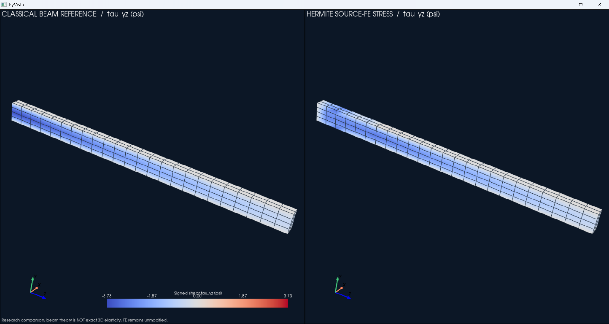
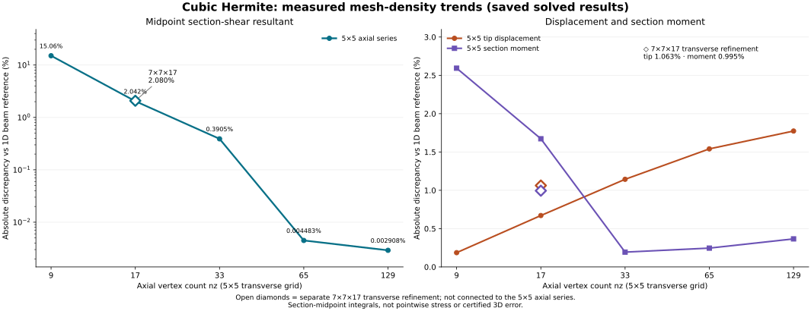

# HermiteStructural_CubicHigherOrder_OOP

Experimental recovered-rotation Hermite elements and conventional nodal Hex27/Hex64 finite elements. **Not certified structural-analysis software.** The Redwood benchmark includes self-weight and consistently integrated end-face traction; its one-dimensional beam reference is not the exact 3D stress solution. This README provides verified commands and distinct experiment records.

> **MANDATORY STRESS-SAMPLING POLICY — NEVER USE CENTROIDS FOR STRESS.**
> Stress maps and sampled extrema must use directly calculated source-element or
> 95%-inset visualization-subcell **corner** stresses. No element-center or
> visualization-subcell-center stress evaluations are permitted in new outputs.
> Existing source-center NPZ archives must be **regenerated**; the viewer rejects them.
> **The 3×3×5 Hex27/Hex64 examples are only 16-element SMOKE TESTS: stress is
> rough and NOT VALIDATED, NOT A FINAL RESULT, and NOT FOR STRUCTURAL DESIGN.**
> See **[mandatory no-centroid stress policy](docs/NO_CENTROID_STRESS_POLICY.md)**.

## Publication evidence and open verification gates (2026-10-29)

**Release characterization: research prototype / reproducible tutorial, NOT a
validated 1%-accurate 3D stress solver.** This package has automated numerical
and source-level checks, but **the 5×5×129 local shear stress has not been
computed**. The historical **0.002908%** number is an integrated section-force
discrepancy at **mesh-dependent axial midpoints**, not a pointwise shear error,
not a certified 3D stress bound, and not a general mesh-convergence rate.
The 5×5×129 tip-deflection discrepancy is **1.773562%** from *approximate*
Euler–Bernoulli beam theory, and increases with axial refinement after 5×5×9.
Agreement with that theory is not the same as verified discretization error.

The historic dense KKT run reports **2.74×10⁻³ RHS-relative infinity-norm
residual** (about **0.274%**) alongside a **4.20×10⁻¹⁷ normwise backward
error**. The scales differ; the small backward error alone does **not** bound
forward error or justify printing 0.002908% as a guaranteed accurate result.
A repeat solve, independent solver refinement, condition assessment, and
location-matched local stress convergence are outstanding.

**Important publication checklist:** run the GUI and all examples on the
intended Windows/Python environment; verify that the expensive dense solve
reproduces the saved measurements; obtain an independent FEM/orthotropic
formulation review; and choose a `LICENSE` before granting reuse rights.
**[Detailed 29 October publication audit](docs/PUBLICATION_AUDIT_20261029.md)**
contains prioritized findings, completed corrections, and commands.

## Verified theoretical beam reference — end traction **and gravity** (2026-10-29)

**Both loads are present in BOTH calculations.** All reported comparisons for
this *default* Redwood cantilever include (1) uniform downward traction on the
free end face and (2) the beam's downward self-weight. The end load is **not**
the only theoretical load. The **weight density** below is a force density in
`lbf/in³`, not a mass density; do **not** multiply by gravitational acceleration
again. This reference uses the uncalibrated longitudinal modulus of Redwood.

| Input (source-code default) | Symbol | Value |
|:--|:--:|--:|
| Beam span (global +z) | $L$ | 120 in |
| Cross-section width (global x) | $b$ | 4 in |
| Cross-section depth (global y) | $h$ | 8 in |
| Free-end load (global −y) | $F=\lvert P\rvert$ | 12.8 lbf |
| Weight density (global −y) | $\gamma$ | 0.0174 lbf/in³ |
| Uncalibrated longitudinal modulus | $E_z$ | 1,100,000 psi |

**Section properties and distributed gravity:**

$$
A = bh = (4)(8) = 32\ \mathrm{in}^2, \qquad
I_x = \frac{bh^3}{12} = \frac{4(8)^3}{12}
= 170.666667\ \mathrm{in}^4.
$$

$$
q = \gamma A = (0.0174)(32)
= 0.5568\ \mathrm{lbf/in}, \qquad
W = qL = (0.5568)(120) = 66.816\ \mathrm{lbf}.
$$

Here $q$ is the uniformly distributed **downward** self-weight per unit span;
$W$ is the weight of the entire 120-inch beam. The total applied vertical force
is $-(F+W)=-79.616\ \mathrm{lbf}$.

**Fixed-support moment and nominal bending stress (including gravity):**

$$
M_{\mathrm{end}} = FL = 12.8(120)
= 1536\ \mathrm{lbf\,in},
$$

$$
M_{\mathrm{gravity}} = \frac{qL^2}{2}
= \frac{0.5568(120)^2}{2}
= 4008.96\ \mathrm{lbf\,in},
$$

$$
M_{\max} = FL + \frac{qL^2}{2}
= 5544.96\ \mathrm{lbf\,in}.
$$

```math
\sigma_{\mathrm{bend,max}} = \frac{M_{\max}(h/2)}{I_x}
= \underbrace{\frac{1536(4)}{170.666667}}_{36.00\ \mathrm{psi\ (end\ load)}}
+ \underbrace{\frac{4008.96(4)}{170.666667}}_{93.96\ \mathrm{psi\ (gravity)}}
= \boxed{129.96\ \mathrm{psi}}.
```

**Classical Euler–Bernoulli free-end displacement (including gravity):**

```math
\delta_y(L) = -\frac{FL^3}{3E_z I_x}
- \frac{qL^4}{8E_z I_x}
= -0.039272727 - 0.076876364
= \boxed{-0.116149091\ \mathrm{in}}.
```

The two terms are, respectively, the downward end traction resultant and
the downward distributed self-weight. No adjustment or calibration of $E_z$
is applied to improve agreement. For completeness, the classical
rectangular-beam *centerline maximum shear stress* reference is

$$
\tau_{yz,\max}^{\mathrm{beam}}
= \frac{3(F+qL)}{2bh}
= \frac{3(12.8+66.816)}{2(4)(8)}
= 3.732\ \mathrm{psi}.
$$

This shear formula is a classical sectional approximation, **not** a
three-dimensional von Mises stress or an exact boundary-layer solution.
Likewise, **129.96 psi is the *nominal outer-fiber bending* reference**,
not a validated maximum 3D von Mises stress. In particular, numerical
agreement with a **16-element smoke-test** von Mises peak is **not** proof
of 1% stress accuracy. Compare equivalent quantities at matching physical
locations on converged meshes. Never replace inset-corner FE stresses with
centroid samples to make a comparison look closer.

**Traceability to the actual FEM and theoretical implementations:**

- **Hex27/Hex64 FEM:** [`tools/p_order_study.py`](tools/p_order_study.py)
  calls `integrate_body_force((0., -density, 0.))` for every source element
  and separately integrates `+Z` end-face traction. The force vector is
  assembled consistently with the same element interpolation.
- **Hermite FEM:** [`tutorials/cantilever.py`](tutorials/cantilever.py)
  sums `gravity_load(beam, a.weight_density)` and
  `build_end_face_traction_load_vector(...)`. The volume integral is in
  [`core/solvers/loads.py`](core/solvers/loads.py).
- **Displacement theory:** [`core/reference/awc.py`](core/reference/awc.py)
  computes **both** `end_load_uy_in` and `self_weight_uy_in`, and returns
  their sum as `total_uy_in`.
- **Stress and load theory:**
  [`core/materials/design_limits.py`](core/materials/design_limits.py)
  uses `M = -tip_force_lbf * length_in + q * length_in**2 / 2` and computes
  maximum bending stress from that **combined** moment. The pointwise
  bending/shear reference, including gravity, is in
  [`core/visualization/cubic_stress.py`](core/visualization/cubic_stress.py).

Confirm the loading and formulas without any expensive production-size solve:

```powershell
python -m unittest tests.test_gravity_reference_contract tests.test_loads -v
```

The checks verify analytical forces, moments, bending stress, displacement,
and **consistent Hex27/Hex64 integrated gravity and end-face loads**. They
are load/reference checks, **not** a proof of FEM stress convergence or
structural-design certification. The values above apply to the default
parameters; overrides such as `--weight-density` or `--end-force` change the
reference and must be reflected in any accompanying table.

## Full-field cubic Hermite shear versus theory (5×5×129)

**This is a new large-mesh workflow, NOT the 16-element Hex64 smoke test.**
The previously recorded **0.002908%** figure is a *section-shear resultant*
discrepancy. It does **not** show that local FE shear stress is within 1% of the
**3.732 psi** classical maximum. The recorded 5×5×129 JSON does **not** retain
full nodal DOFs, so a full-field stress map cannot be reconstructed without a
fresh solve. Do not label the old JSON as a full-field solution archive.

A new `--save-solution` option persists the complete cubic Hermite solved DOF
vector for repeatable **one-sided 95%-inset corner** stress recovery and VTU
visualization *without re-solving*. Unlike earlier averaged-cell displays,
the new VTU stores each original element-sided corner's stress as a separate
VTK **point** value; there are no centroid evaluations, no smoothing between
source elements, and no substitution of the beam reference for FEM stress.

```powershell
# New full 5×5×129 solve: substantial memory required. Saved historic JSON
# contains only scalar QoIs and cannot replace this solve.
python -m tutorials.cubic --nx 5 --ny 5 --nz 129 --section-only --section-axial-positions 0 --save-solution outputs/cubic_5x5x129_solved_dofs.npz --out outputs/cubic_5x5x129.json

# Direct constitutive stress and classical shear at MATCHING inset-corner
# coordinates. Reuse the saved solution for future visualization revisions.
python -m tools.replay_cubic_fields outputs/cubic_5x5x129_solved_dofs.npz --subdivisions 1 --inset 0.95 --out-prefix outputs/cubic_5x5x129

# View the generated results without solving again.
python -m core.visualization.pyvista_viewer outputs/cubic_5x5x129_one_sided_corner_fields.vtu --field "Tau yz (psi)"
python -m core.visualization.pyvista_viewer outputs/cubic_5x5x129_one_sided_corner_fields.vtu --field "Beam theory tau_yz (psi)"
python -m core.visualization.pyvista_viewer outputs/cubic_5x5x129_one_sided_corner_fields.vtu --field "FE minus beam tau_yz (psi)"
python -m core.visualization.pyvista_viewer outputs/cubic_5x5x129_one_sided_corner_fields.vtu --field "Von Mises (psi)"
python -m core.visualization.pyvista_viewer outputs/cubic_5x5x129_one_sided_corner_fields.vtu --field "Vertical displacement magnitude (in)"
```

The matching-location numerical shear comparison and sample positions are
saved in `outputs/cubic_5x5x129_stress_comparison.json`. The full reproducibility
instructions, stress-component commands, gravity accounting, limitations and
memory warning are in **[5×5×129 local-stress workflow](docs/CUBIC_129_LOCAL_STRESS_WORKFLOW.md)**.
The expensive full-density solve **has not been rerun here**, and a local 1%
stress accuracy claim is not established by existing results.

## Mesh previews: Hex8 / Hermite geometry / Hex27 / Hex64

Use a single preview command for **all four mesh families**, before solving. The physical cell wireframe is the default; red interpolation-node markers (`--nodes`) and orange Gaussian-point markers (`--gauss-points`) are optional.

```powershell
python -m tools.mesh_preview --family hermite --nx 3 --ny 5 --nz 25
python -m tools.mesh_preview --family hex8 --nx 3 --ny 5 --nz 25
python -m tools.mesh_preview --family hex27 --nx 3 --ny 5 --nz 25 --nodes
python -m tools.mesh_preview --family hex64 --nx 3 --ny 5 --nz 25 --gauss-points
python -m tools.mesh_preview --family hex64 --nx 3 --ny 5 --nz 25 --summary-only
python -m unittest tests.test_mesh_preview -v
```

**[Complete mesh preview documentation](docs/MESH_PREVIEW.md)** explains counts, overlay options, backward compatibility with `view_hex64_density.py`, and the distinction between Hermite geometry and conventional C0 elements. Visualization does not run a finite-element solve. For results after solving, see [Hex27/Hex64 visual workflow](docs/HEX27_HEX64_VISUAL_WORKFLOW.md).

## Hex27 / Hex64: complete visualization workflow (2026-10-29)

**Planning is not solving.** `tools.p_order_study --mode plan` estimates the mesh and resources only. `--mode solve` performs the FEM solve; add `--field-output outputs/your_case.npz` to export the actual displacement and directly calculated inset-subcell-corner stress data. `samples/cubic_3x3x9.vtu` is a **different Hermite formulation** and must not be presented as the result of these studies.

The full copy/paste **mesh preview → solve → report → field heatmaps → interactive 3D** procedures for **both Hex27 and Hex64**, including tension, compression, von Mises, shear components and displacement, are in **[docs/HEX27_HEX64_VISUAL_WORKFLOW.md](docs/HEX27_HEX64_VISUAL_WORKFLOW.md)**. Large solves are opt-in, not silently launched. The report PNG also compares |tau_yz| shear with a beam approximation. The 3D stress display shows *directly evaluated inset-corner sampled* stresses, with each subcell colored by an extreme of its eight corner samples. No centroids are used. These sampled extrema are **not** certified 3D maxima.

Two already-solved 3×3×5 conventional examples are included as actual field
archives—**Hex27** `samples/hex27_3x3x5_fields.npz` and **Hex64**
`samples/hex64_3x3x5_fields.npz`, with corresponding JSON and section CSV.
They are **SMOKE TEST ONLY — STRESS NOT VALIDATED, NOT FOR DESIGN** 16-cell examples, *not* the dense 192-cell experiment. After
installing PyVista, open their raw sample fields without a new FEM solve:

```powershell
python -m tools.nodal_field_viewer samples/hex27_3x3x5_fields.npz --mesh-only
python -m tools.nodal_field_viewer samples/hex64_3x3x5_fields.npz --field "Displacement magnitude (in)"
python -m tools.nodal_field_viewer samples/hex64_3x3x5_fields.npz --field "Tension zz (psi)"
python -m tools.nodal_field_viewer samples/hex64_3x3x5_fields.npz --field "Compression zz (psi)"
python -m tools.nodal_field_viewer samples/hex64_3x3x5_fields.npz --field "Von Mises (psi)"
python -m tools.nodal_field_viewer samples/hex64_3x3x5_fields.npz --field "Tau yz (psi)"
```

Quick small Hex64 example:

```powershell
python -m tools.convergence_study --stage mesh --order 3 --levels "3,3,5" --out outputs/hex64_smoke
python -m tools.convergence_study --stage solve --order 3 --levels "3,3,5" --out outputs/hex64_smoke
python -m tools.convergence_study --stage report --order 3 --levels "3,3,5" --out outputs/hex64_smoke
python -m tools.convergence_study --stage view --order 3 --levels "3,3,5" --out outputs/hex64_smoke
# WARNING: SMOKE TEST ONLY — 16 cells; stress is NOT VALIDATED, NOT FINAL,
# NOT FOR STRUCTURAL DESIGN. Displayed values are inset-corner samples.
python -m tools.nodal_field_viewer outputs/hex64_smoke/hex64_3x3x5.npz --field "Von Mises (psi)"
```

## Separate OOP nodal-element refactor (2026-10-29)

**Start here:** [29 October release audit](docs/AUDIT_20261029.md) · [OOP tutorial](docs/OOP_TUTORIAL.md) · [tracked TODO checklist](docs/OOP_TODO.md) · [verification report](docs/BUILD_REPORT_OOP.md).

This separate project refactors the **conventional C0 Hex27/Hex64** study
with element objects, named six-face traction integration, cached Gaussian
quadrature, lazy shared local stiffness, bounded-batch sparse global assembly,
and named verification-report functions. The prior recovered-rotation Hermite
research solvers remain in the project **unchanged** by this OOP conversion.
This is not a certified a posteriori error bound.

From this directory, with ordinary Python (no virtual environment required):

```powershell
python -m tools.demo_nodal_oop --order 3
python -m unittest tests.test_nodal_oop tests.test_p_order_study -v
# Optional small-assembly memory measurements:
python -m tools.benchmark_nodal_assembly --order 3
python -m unittest discover -s tests -v
python -m tools.p_order_study --mode verify --order 3
python -m tools.p_order_study --mode solve --order 3 --nx 3 --ny 3 --nz 5
```

### Run the independent facet traction regression

```powershell
python -m unittest tests.test_facet_traction_independent.TestIndependentFacetTraction.test_polynomial_vs_gaussian_all_faces_hex27_hex64 -v
# Print all numeric differences:
python -m tests.test_facet_traction_independent --show-results
```

See [unit-testing documentation](docs/UNIT_TESTING.md) for the independent
exact-polynomial reference, assertions, tolerances and test scope.

The larger `--nx 3 --ny 5 --nz 25` **Hex64 solve is not run by default**:
check `--mode plan` first and explicitly use `--accept-expensive-run` for
more than 8,000 DOFs. New OOP files are detailed in the tutorial; the
original README follows for the preserved historical experiments.

---

## Redwood Hermite bending research

Three active **recovered-rotation Hermite** formulations (linear, quadratic,
cubic), each with a PyVista viewer and VTU export. **Grade-aligned Redwood
material, conservative load screening, and a quantitatively audited cubic
longitudinal stress-distribution viewer** are included. In one axial midpoint
section-resultant comparison, the beam-reference shear discrepancy decreased
from **20.5657% on 3×3×9 to 0.0029% on 5×5×129**. This is a single-section
result, not a full-field shear-accuracy or convergence claim; other samples
show larger local discrepancies. All numerical claims are research results,
**not** certified a posteriori bounds or construction design approval. See
the [shear and moment-balance investigation](docs/SHEAR_BALANCE_INVESTIGATION_20261027.md)
and [transverse-warping benchmark](docs/TRANSVERSE_CUBIC_SHEAR_RECOVERY_20261027.md)
for the sampling limits and additional measurements.

## New: conventional Hex27 and Hex64 comparison (27 October 2026)

An **independent optional** C0 tensor-product nodal solver now tests quadratic
Hex27 and cubic Hex64 at the **same number of physical source cells** as the
original cubic recovered-rotation Hex8. It does not replace or edit the
existing Hermite solver. At the existing `3×5×25` vertex grid this corresponds
to 192 physical elements, 6,615 Hex27 translational DOFs, and 19,929 Hex64
translational DOFs (potentially costly sparse direct solves). Higher-order
faces carry 9 or 16 interpolation nodes, **not** additional independent
geometric faces. Matched displacement-only clamps are strongly recommended
for comparison with Hermite; the old fixed-rotation baseline is not a
strictly identical boundary condition.

```powershell
python -m unittest tests.test_p_order_study -v
python -m tools.p_order_study --mode plan --order 2 --nx 3 --ny 5 --nz 25
python -m tools.p_order_study --mode plan --order 3 --nx 3 --ny 5 --nz 25
# Explicit small 16-element smoke solves, NOT the full 192-element study.
# --field-output is required to save data for the interactive field viewer:
python -m tools.p_order_study --mode solve --order 2 --nx 3 --ny 3 --nz 5 --field-output outputs/hex27_3x3x5_fields.npz
python -m tools.p_order_study --mode solve --order 3 --nx 3 --ny 3 --nz 5 --field-output outputs/hex64_3x3x5_fields.npz

# View each solved mesh (PyVista interactive windows):
python -m tools.nodal_field_viewer outputs/hex27_3x3x5_fields.npz --mesh-only
python -m tools.nodal_field_viewer outputs/hex64_3x3x5_fields.npz --mesh-only

# SMOKE TEST ONLY: stress is NOT VALIDATED or suitable for structural design.
# View displacement, axial tension/compression, von Mises, and shear:
python -m tools.nodal_field_viewer outputs/hex27_3x3x5_fields.npz --field "Displacement magnitude (in)"
python -m tools.nodal_field_viewer outputs/hex27_3x3x5_fields.npz --field "Tension zz (psi)"
python -m tools.nodal_field_viewer outputs/hex27_3x3x5_fields.npz --field "Compression zz (psi)"
python -m tools.nodal_field_viewer outputs/hex27_3x3x5_fields.npz --field "Von Mises (psi)"
python -m tools.nodal_field_viewer outputs/hex27_3x3x5_fields.npz --field "Tau yz (psi)"
python -m tools.nodal_field_viewer outputs/hex64_3x3x5_fields.npz --field "Displacement magnitude (in)"
python -m tools.nodal_field_viewer outputs/hex64_3x3x5_fields.npz --field "Tension zz (psi)"
python -m tools.nodal_field_viewer outputs/hex64_3x3x5_fields.npz --field "Compression zz (psi)"
python -m tools.nodal_field_viewer outputs/hex64_3x3x5_fields.npz --field "Von Mises (psi)"
python -m tools.nodal_field_viewer outputs/hex64_3x3x5_fields.npz --field "Tau yz (psi)"
```

The `--mode plan` commands only estimate resources and create **no solution archive**.
The `--field-output` option on each `--mode solve` command writes the `.npz`
needed by the viewer. Each viewing command opens one field; close the window
before launching the next. For a ParaView-compatible export, add
`--vtu outputs/hex64_3x3x5.vtu` to any Hex64 viewer command (similarly for
Hex27). SMOKE TEST WARNING: the 16-element stress views are rough research demonstrations,
not validated stress results or design values. All stress samples come directly
from 95%-inset corners of fine visualization subcells (eight per subcell);
centroid stress is prohibited. The sampled peaks are **not certified maxima**. If you want to skip the solves, use the included
`samples/hex27_3x3x5_fields.npz` and `samples/hex64_3x3x5_fields.npz` instead.

**Hex64 is the cubic Lagrange hexahedron with 64 interpolation nodes per
element (4×4×4), compared with Hex27's 27 nodes (3×3×3).** These are shared
displacement nodes, with three translational DOFs each. The cubic Hermite
Hex8 formulation uses eight geometric vertices and nonlocal recovery, so
the word “cubic” refers to different constructions in these two families.

The following table includes both available mesh sizes. “Source vertex grid”
describes the cell layout; “global nodes” counts the actual shared
interpolation nodes, including the extra nodes within Hex27/Hex64 elements.
Both conventional families use translation-only clamps and the same
material, loading, and section-sampling convention.

| Element type | Source vertex grid | Physical cells | Global nodes | Tip vs beam (%) | Max middle-half section shear vs beam (%) | Max middle-half section moment vs beam (%) |
|:--|:--|--:|--:|--:|--:|--:|
| Quadratic Lagrange Hex27 | 3×3×5 | 16 | 225 | +1.3648 | +72.61185 | +7.95556 |
| Cubic Lagrange Hex64 | 3×3×5 | 16 | 637 | +1.8750 | −2.53271 | −0.40601 |
| Quadratic Lagrange Hex27 | 3×5×25 | 192 | 2,205 | ±2.0021* | ±2.1811* | ±0.16016* |
| Cubic Lagrange Hex64 | 3×5×25 | 192 | 6,643 | ±2.0244* | **±0.01313*** | **±0.000328*** |

**Sign convention:** Signed differences compare FEM magnitudes against the corresponding beam-reference magnitudes: `100 × (|FEM| − |beam|) / |beam|`. **+** means higher FEM magnitude; **−** means lower. Section signs refer to the locations of the respective maximum middle-half discrepancies. **±*** means the original unsigned magnitude is preserved, but its direction cannot be established from the archived summary alone; the 3×5×25 raw solve/section records are not included in this repository. No sign is assumed.

On the denser 192-cell mesh, Hex64 gives the smaller section-shear and
section-moment discrepancies; Hex27 is slightly closer on tip displacement.
The Hex64 mesh has 19,929 translational DOFs versus Hex27's 6,615. These
results support Hex64 for the measured section resultants; the available
two mesh levels do not establish a general convergence rate.

The full data, two-mesh plot, limitations, mechanics, section-stress,
reaction/moment-balance, and work-energy checks are in the
[Hex27/Hex64 study](docs/HIGHER_NODE_HEX27_HEX64_STUDY_20261027.md). The
reproduction commands remain opt-in. No classical-beam discrepancy is a
certified 3D error bound.

## PyVista: classical vs Hermite shear-stress meshes (2026-10-27)

The cubic example now includes **two synchronized shear-stress mesh views**:
**left = independent classical rectangular-beam `tau_yz` reference**, and
**right = unmodified constitutive cubic Hermite `tau_yz`**, both in psi and
with the **same signed color scale**. Every visualization cell carries
**eight independently evaluated, one-sided original source-element corner stresses**;
no hidden smoothing across element boundaries. The paired dataset exports
as a separate `.vtu` and may be reopened without rerunning the solver.
A **ready-to-view 3×5×25 source mesh** is shipped as
`samples/cubic_3x5x25_shear_comparison.vtu`.


The theoretical shear is from the classical `VQ/(It)` beam approximation,
not directly from a stress-cube diagram and not an exact 3D solution.

```powershell
python -m tutorials.cubic --nx 3 --ny 5 --nz 25 --shear-comparison --full-screen --edges --out outputs/cubic_dual_shear.json
# Off-screen dual-panel image instead of a GUI window:
python -m tutorials.cubic --nx 3 --ny 5 --nz 25 --shear-comparison --off-screen --out outputs/cubic_shear_figure.json
# Reopen the comparison without recomputing the beam:
python -m core.visualization.shear_comparison outputs/cubic_dual_shear_shear_comparison.vtu --full-screen
```

See **[Two-view PyVista shear tutorial](docs/DUAL_SHEAR_PYVISTA.md)** for the
specific BEAM/FE equations, mesh sampling, supported command flags, screenshot
export, original-vs-display element distinction, and limitations. This new
viewer does **not** modify the FE formulation or constitute 3D certification.

## Transverse cubic warping and the 3×5×25 shear benchmark (2026-10-27)

**A real improvement in the unmodified computed shear stress has been reproduced.**
The earlier 3×3×9 mesh has only three node layers across the beam depth;
its cubic recovery cannot reproduce the transverse `u_z=y^3` warping mode
whose derivative produces quadratic shear strain. A new independent B/T
polynomial patch demonstrates this: about 33% sampled strain discrepancy
on 3×3×9, versus floating-point precision when `ny >= 4`.

With **3×5×25**, the *raw original-source-corner* `tau_yz` discrete interior
L2 difference from beam theory is **1.669%** (from **73.875%** on 3×3×9),
while `sigma_zz` is **0.398%**, sectional shear **0.604%**, sectional moment
**0.998%**, and tip displacement **0.989%**. On the same 3×5 cross-section,
axial refinement lowers this corner-sample shear difference to **0.918% at
3×5×41** and **0.912% at 3×5×49**. Thus it falls below 1% for this discrete
beam-reference comparison by 41 axial nodes. Tip displacement disagreement
increases to 1.321% and 1.413% on those meshes, respectively. The separate
3×4×25 case measures **3.570%** for this corner-sample shear metric.

At 3×5×25 the FE shear has a **slightly larger fitted overall magnitude**
than the beam reference: projecting the equally weighted FE corner samples
onto the beam samples gives a scale of 1.0066. Individual samples both
exceed and fall below the beam reference in magnitude, so there is no single
pointwise direction. At
3×5×9 and 3×5×17, the same fitted scale is below one; the direction changes
with refinement. The solver, its stress field and material properties were
not modified to obtain these values. A coarse cubic run with `ny=3` prints a
warning.

**What 1.669% measures:** the equally weighted relative L2 difference between
raw FE `tau_yz` and classical beam-theory `tau_yz` at source-element corners
in the middle half of the span (`L/4 <= z <= 3L/4`). Element-side values at
shared vertices are counted separately. It is neither a maximum pointwise
error nor a volume-integrated 3D error, and it does not establish equilibrium.
The fitted scale above is `sum(tau_FE * tau_beam) / sum(tau_beam^2)` over
those same samples; it summarizes overall amplitude and does not describe
local over- or under-shoots.

An additional sample-based FE `dM/dz`/shear-balance diagnostic still shows
up to **31.36%** discrepancy at individual Gaussian sections; complete
three-dimensional stress equilibrium is **not yet established**.

**These are research comparisons against beam theory—not a certified 3-D
stress error bound or proof of monotonic convergence.** Both configurations
still require equilibrium, free-surface-traction and common-norm convergence
checks before engineering validation. See
[transverse cubic shear recovery investigation](docs/TRANSVERSE_CUBIC_SHEAR_RECOVERY_20261027.md).

```powershell
python -m unittest tests.test_cubic_shear_warping -v
python -m tutorials.cubic --nx 3 --ny 5 --nz 25 --section-only --nodal-stress-audit --shear-warping-audit --out outputs/shear_improved_3x5x25.json
python -m tutorials.cubic --nx 3 --ny 5 --nz 41 --section-only --nodal-stress-audit --out outputs/shear_depth_3x5x41.json
python -m tutorials.cubic --nx 3 --ny 5 --nz 49 --section-only --nodal-stress-audit --out outputs/shear_depth_3x5x49.json
```

## Update: original-node/corner stress evaluation (2026-10-27)

**Current runs now evaluate stress at original source-element vertices and at
visualization-subcell corners, rather than relying on cell-center stress
samples.** The raw stress at each corner comes directly from the source Hermite
operator, `sigma = D @ (B @ T @ U)`. Each element-side value remains distinct:
shared-vertex values are **not** averaged across neighboring source elements.
The optional `--stress-sample-location inset_corners` uses stable inset corners;
`exact_corners` is the new default. The visualization uses a **mean of eight
subcell-corner stresses only for cell coloring**; diagnostic peaks and the
stress L2 screening instead use **individual corner stresses**. They are not
an exact full-field norm or a certified stress estimate.

The 3×3×9 sample is a cautionary demonstration: the independent *source-vertex*
discrete beam comparison measured **5.451% longitudinal-stress L2** and
**73.875% shear-stress L2** at exact source corners; with 95%-inset source
corners those numbers were approximately **5.247%** and **68.865%**.
These numbers are **not directly comparable** with the older 1.163% or
2.16% interior subcell-center longitudinal norms or midpoint sectional shear
resultants: their sampling supports and norms differ. The poorer corner
measurements expose a real verification gap and are not fixed by moving the
reporting location. Tip displacement is unchanged at **0.465124%** for this
mesh. **Do not claim nodal stress convergence or stress certification.**

The default source-sectional diagnostic now evaluates near axial-element faces
at parent `zeta=-0.9,+0.9`, not a midpoint. It still uses **cross-sectional
Gaussian integration to calculate force and moment**; this is a mathematically
necessary numerical integral, not a request to substitute a centroid stress.
Stiffness, loads and strain energy also retain appropriate Gaussian
quadrature. The sampled volume equilibrium default now uses eight interior
Gauss points/cell instead of one midpoint. Historical results and their
midpoint definitions are retained in the tables below and can be reproduced
with `--section-axial-positions 0`.

```powershell
python -m tutorials.cubic --nx 3 --ny 3 --nz 9 --section-only --nodal-stress-audit --out outputs/original_vertex_3x3x9.json
python -m tutorials.cubic --nx 3 --ny 3 --nz 9 --section-only --nodal-stress-audit --stress-sample-location inset_corners --stress-inset-fraction 0.95 --out outputs/inset_vertex_3x3x9.json
python -m tutorials.cubic --nx 3 --ny 3 --nz 9 --stress-audit --equilibrium-diagnostics --out outputs/corner_visual_stress_3x3x9.json
```

See [original-vertex stress evaluation and point ownership](docs/CORNER_STRESS_EVALUATION_20261027.md).

## New: sectional-shear oscillation and FE moment-balance investigation

The original cubic stress operator is unchanged. The coarse 3×3×9 example
shows substantial **axial variation of the raw sectional shear integral**:
20.566% midpoint disagreement is not a constant stress error. Four-point
axial sampling now separately reports local shear, per-cell axial shear
averages, and the derivative of **FE** integrated bending moment. The coarse
mesh still has unresolved local balance defects; averaging is **not** a fix.
The striking 5×5×129 0.0029% midpoint-only agreement must **not** be
presented as full-field shear accuracy or a posteriori certification.

```powershell
python -m tutorials.cubic --nx 3 --ny 3 --nz 9 --section-only --shear-balance --out outputs/cubic_3x3x9_shear_research.json
python -m unittest tests.test_shear_balance -v
```

See [Axial shear investigation](docs/SHEAR_BALANCE_INVESTIGATION_20261027.md)
for measured results, unchanged code paths, clamp comparison, and the proposed
validation/refinement plan.

## New: independent Mechanics of Materials benchmark suite

The cubic source formulation now has reproducible **stress-cube transformation,
principal-stress, tension/compression/shear/pure-bending polynomial patch,
independent point-load/self-weight reference, and energy-identity tests**.
All nine quick CLI checks pass locally; ten focused unit tests pass. An
**opt-in solved-cantilever audit** compares signed source stresses and
centerline displacement to separate analytical beam fields, and checks
source-integrated FE strain energy against applied discrete work. These
checks strengthen verification **without pretending to provide a certified
*a posteriori* 3D error bound**. The existing solver element, material and
boundary-condition algorithms are unmodified.

```powershell
python -m unittest tests.test_mechanics_benchmarks -v
python -m tools.mechanics_benchmarks --out outputs/mechanics_benchmarks.json
python -m tutorials.cubic --nx 3 --ny 3 --nz 5 --section-only --mechanics-audit --out outputs/beer_validation_cubic_3x3x5.json
```

Read the [Mechanics of Materials verification report](docs/MECHANICS_OF_MATERIALS_VERIFICATION.md)
for the equations, signs, six stress components, reproducible solved example,
and precise **uncertified** limitations.

## Status and scope

**Experimental numerical research and software demonstration—not a certified
structural-analysis product.** The 3×3×9 cubic example reproduces a classical
*interior longitudinal bending-stress trend*, but it has **not** established
accurate full-field 3D stresses, design adequacy, or a posteriori certification.
The linear bending response remains visibly too stiff; the quadratic and cubic
formulations are not standard Hex27/Hex64 elements. **Do not use this software
for safety-critical design decisions.**

The repository's unit tests deliberately do **not** claim to validate a graphical
PyVista window on every operating system. After installing on Windows, run the
manual smoke checks in [the release checklist](docs/RELEASE_CHECKLIST.md).

## Next milestone: cubic refinement and a posteriori verification

Cubic recovery is the most promising **of the three current research variants**:
the measured 3×3×9 example reaches **0.465% tip displacement disagreement**
and **2.16% sampled interior longitudinal-stress disagreement** versus
classical beam theory. However, the corresponding maximum interior sectional
shear-resultant discrepancy is **19.82%**, and the stress comparison depends
on sampling. **New finer-mesh tip and source-Gauss section-resultant
measurements appear below, but no finer-mesh longitudinal stress-map
validation or rigorous 3D error bound is claimed.**

The project is **set up to begin the a posteriori verification programme**:
we have explicit QoI/reference diagnostics, beam/load checks, mesh-comparison
postprocessing, and a machine-readable *fail-closed* certification checklist.
It is **not yet an implemented, certified a posteriori estimator**; no
admissible equilibrated-stress reconstruction or guaranteed Hermite error bound
has been proven. See [Cubic refinement and a posteriori roadmap](docs/CUBIC_REFINEMENT_AND_APOSTERIORI.md)
and [Certification status](docs/CERTIFICATION_STATUS.json).

### Cubic Hermite Hex8 densification: section-resultant study

We have **new measured results** from direct fourth-order Gaussian integration
of the *original cubic element's* constitutive stress over each axial-element
mid-section. These are not derived from the PyVista cell-center display grid.
The 3×3×9 → 5×5×129 result is approximately **7,072 times smaller** for this
specific shear-resultant discrepancy. The table also records displacement
and moment so that the improvement can be assessed alongside other quantities.

| Element formulation | Node mesh | Tip vs beam (%) | Tip ± (%) | Max interior section shear vs beam, signed (%) | Shear ± (%) | Max interior section moment vs beam (%) | Moment ± (%) |
|:--|:--|--:|--:|--:|--:|--:|--:|
| Cubic Hermite Hex8 (nonlocal recovery) | 3×3×5 | 1.165 | −1.165 | +18.84 | +18.84 | 9.35 | +9.35 |
| Cubic Hermite Hex8 (nonlocal recovery) | 3×3×9 | 0.465 | −0.465 | −20.57 | −20.57 | 3.23 | −3.23 |
| Cubic Hermite Hex8 (nonlocal recovery) | 3×3×17 | 0.408 | +0.408 | −8.05 | −8.05 | 2.30 | −2.30 |
| Cubic Hermite Hex8 (nonlocal recovery) | 3×3×33 | 1.108 | +1.108 | −6.12 | −6.12 | 0.32 | −0.32 |
| Cubic Hermite Hex8 (nonlocal recovery) | 5×5×9 | **0.186** | +0.186 | −15.06 | −15.06 | 2.59 | −2.59 |
| Cubic Hermite Hex8 (nonlocal recovery) | 5×5×17 | 0.671 | +0.671 | −2.04 | −2.04 | 1.67 | −1.67 |
| Cubic Hermite Hex8 (nonlocal recovery) | 5×5×33 | 1.144 | +1.144 | +0.39 | +0.39 | 0.19 | −0.19 |
| Cubic Hermite Hex8 (nonlocal recovery) | 5×5×65 | 1.541 | +1.541 | +0.0045 | +0.0045 | 0.25 | +0.25 |
| Cubic Hermite Hex8 (nonlocal recovery) | 5×5×129 | 1.774 | +1.774 | +**0.0029** | +0.0029 | 0.37 | +0.37 |
| Cubic Hermite Hex8 (nonlocal recovery) | 7×7×17 | 1.063 | +1.063 | −2.08 | −2.08 | 1.00 | −1.00 |

**Signed comparison (±):** Each signed value compares the FEM **magnitude** with the beam-reference magnitude: `100 × (|FEM| − |beam|) / |beam|`. **+** means the FEM magnitude is higher; **−** means it is lower. The shear column now displays the signed difference directly; its adjacent Shear ± column retains the same signed value for compatibility. The tip and moment unsigned columns retain their original absolute differences. For shear and moment, the sign is evaluated at the interior section where that row's respective reported maximum discrepancy occurs (within the central half-span, 30–90 in); the two locations can differ. These are integrated section resultants, not pointwise stress errors.

For the higher-node cubic element, see the **Hex64 rows** in the
[Hex27/Hex64 results table above](#new-conventional-hex27-and-hex64-comparison-27-october-2026).
Those conventional-element runs use a translation-only clamp; this Hermite
table uses the displacement-trace clamp plus fixed nodal rotations.



**Additional recorded density level:** The open diamond represents **7×7×17** (greater transverse density), NOT a sixth point on the 5×5 axial-refinement curve. Compared with 5×5×129, its tip-reference discrepancy is **1.063% rather than 1.774%** (closer to the beam reference), but its **section-shear resultant** discrepancy is **2.080% rather than 0.0029%** (farther from the beam reference) and its section-moment discrepancy is **0.995% rather than 0.366%**. Those are section integrals, **not local tensile, compressive, von Mises, or shear stress map errors**. This comparison changes both element size and sampling positions, so it cannot prove an h-convergence order or a more accurate 3D solution.

Regenerate this graph **from the included measured source-section JSON files** (no solve needed):

```powershell
python -m tools.plot_cubic_densification
# Optional different destination:
python -m tools.plot_cubic_densification --out outputs/cubic_densification.svg
```


This table and figure report **only** the nonlocal cubic Hermite formulation on
Hex8 connectivity. They are still the correct record of that formulation's
densification study; they are not Hex27/Hex64 results and should not be read as
a comparison across element families. The conventional-element runs are
reported separately in the [Hex27/Hex64 study](docs/HIGHER_NODE_HEX27_HEX64_STUDY_20261027.md).

**The higher-density test extends the measured shear-resultant trend.**
The 5×5×129 run halves axial element length again and reduces the midpoint
section-shear discrepancy from 0.0045% to 0.0029%. Tip-to-beam disagreement
rises to 1.774%, and moment disagreement rises from 0.25% to 0.37%.
The separate 7×7×17 cross-section
refinement stays near 2.08% shear, while axial refinement at 5×5 changes the
section resultants much more. These are integrated resultants, not pointwise
stress errors: weak FE equilibrium can make section forces accurate while
the local stress distribution and sampled volume-equilibrium residual remain
inaccurate. Mesh-dependent section locations also limit comparisons. No row
proves a three-dimensional exact-solution error or a certified bound.

**Section-location check:** a fresh 5×5×65 run sampled quarter, middle and
three-quarter positions in every axial element. The worst shear-resultant
discrepancy across this expanded set was **0.0230%**, compared with 0.0045%
at midpoints alone. The 5×5×129 figure above uses midpoint sections only.

See [Source-Gauss section study](docs/SECTION_EQUILIBRIUM_REFINEMENT_20261026.md)
and [Higher-density test and section-location sensitivity](docs/DENSIFICATION_STUDY_20261026.md)
for exact commands, measured data, BC comparison and limitations. These
section-only meshes ran locally in about 29 seconds (5×5×17), 85 seconds
(5×5×33), 142 seconds (5×5×65), and 101 seconds (7×7×17). For large-mesh
runs with no visualization cost:

```powershell
python -m tutorials.cubic --nx 3 --ny 3 --nz 17 --section-only --out outputs/cubic_3x3x17.json
python -m tutorials.cubic --nx 3 --ny 3 --nz 33 --section-only --out outputs/cubic_3x3x33.json
python -m tools.section_refinement outputs/cubic_3x3x17.json outputs/cubic_3x3x33.json
```

The measured 5×5 axial series and the new high-density case are reproducible:

```powershell
python -m tutorials.cubic --nx 5 --ny 5 --nz 129 --section-only --out outputs/cubic_5x5x129.json
python -m tools.section_refinement samples/cubic_5x5x17.json samples/cubic_5x5x33.json samples/cubic_5x5x65.json samples/cubic_5x5x129.json
```

Further progress toward **a posteriori** readiness: an optional numerical
internal-face traction jump audit and sampled \(\nabla\cdot\sigma+b\)
volume-equilibrium check now diagnose the raw constitutive stress. The tested
internal-face traction jumps are at floating-point noise, but **volume balance
is not exact**. Using eight interior Gauss points per element, sampled residual
RMS values for 3×3×9, 3×3×17, and 3×3×33 were approximately 1.828, 1.514,
and 1.368 lbf/in³, respectively. At *one* element center per cell they were
0.852, 0.703, and 0.663 lbf/in³ instead. Those values are strongly
sampling-dependent: **do not label them certified errors**.

```powershell
python -m tutorials.cubic --nx 3 --ny 3 --nz 9 --section-only --equilibrium-diagnostics --out outputs/cubic_3x3x9.json
# Optional, more expensive eight-point/cell check:
python -m tutorials.cubic --nx 3 --ny 3 --nz 9 --section-only --equilibrium-diagnostics --volume-residual-order 2 --out outputs/cubic_3x3x9_eightpoint.json
```

`--section-only` **does not perform sampled-stress screening**. It does still
execute the basic Redwood reference load screen and generate the direct FE
section-resultants report. `--linear-solver pypardiso` is an optional,
user-installed accelerated backend, not a project installation requirement.

To inspect readiness and perform a **new, controlled cubic axial-refinement
experiment**, use PowerShell from the repo root (larger solves are run only on
your machine, not by the unit tests):

```powershell
python -m tests.checks.certification_readiness
python -m tutorials.cubic --nx 3 --ny 3 --nz 17 --subdivisions 3 --out outputs/cubic_3x3x17.json
python -m tools.cubic_refinement samples/cubic_3x3x9.json outputs/cubic_3x3x17.json
```

The comparator reports intermesh QoI changes; **these are not a posteriori
upper bounds**. For uniform refinement of all element dimensions, the next
research mesh after 3×3×9 is 5×5×17, not 3×3×17. Detailed commands and
workload cautions are in the roadmap above. Run `--require-certified` only
when explicitly testing the expected failure of the certification gate.

## Install and verify (Windows PowerShell, global Python)

```powershell
python -m pip install -r requirements.txt
python -m unittest discover -s tests -v
python -m tests.checks.element_modes
python -m tests.checks.source_provenance
```

## Launch the supplied viewer samples (no solve required)

```powershell
python -m core.visualization.pyvista_viewer samples/cubic_3x3x9.vtu
python -m core.visualization.pyvista_viewer samples/cubic_3x3x9.vtu --field "Absolute longitudinal stress (psi)"
python -m core.visualization.pyvista_viewer samples/cubic_3x3x9.vtu --field "Sigma zz (psi)"
```

The first view displays `|Uy|`, **blue = least motion / red = greatest
motion**. The second shows absolute bending stress, and the third preserves
the physical **tension (+red) / compression (−blue)** sign. Yellow cubes identify
**fixed original mesh nodes at `z=0`**; the other end is free/loaded (`z=120`).
The beam shape is visually magnified by default; the numerical fields are not.
Full shortcut list: [Visualization](docs/VISUALIZATION.md).

## Redwood material and load — physically screened

The new benchmark prescribes Redwood **Select Structural dimension lumber**
reference values: `E_L = 1,100,000 psi`, bending `Fb = 1,100 psi`, tension
parallel `Ft = 625 psi`, shear parallel `Fv = 160 psi`, compression parallel
`Fc = 1,100 psi`, and compression perpendicular `Fc⊥ = 425 psi`, according to
[Redwood Structural Design Values](https://getredwood.com/wp-content/uploads/2024/07/2022-Structural-Design-Values.pdf).

### Redwood Select Structural reference values

| Property | Reference value |
|:--|--:|
| Bending | 1,100 psi |
| Tension parallel to grain | 625 psi |
| Shear parallel to grain | 160 psi |
| Compression parallel to grain | 1,100 psi |
| Compression perpendicular to grain | 425 psi |

This is an *idealized* 4 × 8 × 120 in model; its research orthotropic ratios
are not a complete graded-material dataset. Values are **unadjusted design
references, not fracture strengths**. Actual members require design adjustments,
connection checks, stability checks, perpendicular-to-grain tension assessment,
and an engineer. Displacement is screened using a separate **L/360
serviceability example**, not a Redwood damage threshold. Von Mises is **not**
a failure criterion for anisotropic wood.

Load: **−12.8 lbf downward end-face traction** plus an **assumed** 0.0174 lbf/in³ specific weight (~30.1 lbf/ft³)
**volume-integrated self-weight** (−66.816 lbf), total −79.616 lbf.
The load is retained because preliminary bending/shear/deflection checks pass.
`--end-force` can change the signed traction; values that fail the preliminary
Redwood check are rejected **before** the solver. The cubic demo also runs a
sampled-FE stress screen and writes a report. This is not an assurance that
unsampled maxima or other failure modes cannot exceed limits.

## Same mesh, all three formulations

**3×3×5 nodes (16 source Hex8 cells)**, same loads and revised grade-aligned
modulus for every row:

| Hermite formulation | Tip displacement | Signed displacement-magnitude difference from beam theory |
|:--------------------|-----------------:|----------------------------:|
| Linear | −0.005386 in | −95.36% |
| Quadratic | −0.094852 in | −18.34% |
| Cubic | −0.114796 in | −1.16% |

Beam-theory reference: **−0.116149 in**. The linear formulation is still far
too stiff, while cubic is better on this mesh. The signed percentages compare displacement **magnitudes**: `100 × (|FEM| − |beam|) / |beam|`; negative means less downward deflection than beam theory. They quantify **beam agreement only**; they are not error certificates.

```powershell
python -m tutorials.linear --nx 3 --ny 3 --nz 5
python -m tutorials.quadratic --nx 3 --ny 3 --nz 5
python -m tutorials.cubic --nx 3 --ny 3 --nz 5
python -m tools.compare_results
```

### Cubic: stress distribution, a separate quantitative check

The two cubic mesh studies are summarized below:

| Cubic mesh | Signed tip displacement-magnitude difference | Interior longitudinal stress relative L² discrepancy (unsigned) |
|:--|--:|--:|
| 3×3×5 | −1.165% | 9.12% |
| 3×3×9 | −0.465% | 2.16% |

The signed tip figures compare FE deflection magnitudes with the same analytical beam
reference (negative means less downward deflection). The stress figures remain **unsigned relative L² differences** between sampled
Hermite longitudinal bending stress `σzz` and classical beam theory over
the central half of the beam. The 3×3×5 diagnostic used 2 visualization
subdivisions; the 3×3×9 diagnostic used 3, so the figures also reflect
sampling choices. Neither column is a rigorous a posteriori error bound,
and neither verifies the full three-dimensional stress field.

With **3×3×9 nodes**, the cubic beam has a free-end deflection of
**−0.115609 in**, a **0.465%** discrepancy against beam theory. The interior
longitudinal bending stress `σzz`, measured from *actual Hermite strain
operators* at subdivision-3 cell centers, has a **2.16% relative L²
comparison discrepancy** versus the separate classical beam reference.
At subdivision 2 this diagnostic was **1.16%**: stress comparisons are
sampling-sensitive. **The full 3D stress distribution is not validated:**
the 3×3×9 sectional shear-resultant maximum discrepancy was **12.23% at
subdivision 2** and **19.82% at subdivision 3**, over the interior
quarter-to-three-quarter span. These are different sampling grids, not
a strictly controlled mesh-convergence comparison. The cubic output saves both **unmodified FE stress**
and **beam reference stress** with a **signed difference contour**, plus
section moment/shear checks and per-component Redwood stress utilizations.

```powershell
python -m tutorials.cubic --nx 3 --ny 3 --nz 9 --subdivisions 3 --view --full-screen --export-vtu --field "Sigma zz (psi)"
Get-Content outputs/cubic_stress_audit.json
```

The default viewer field is **vertical displacement magnitude `|Uy|`**;
blue denotes least movement and red denotes greatest movement. `U` displays
signed displacement (negative downward); a signed plot uses blue for negative
values and red for positive values. Deformation magnification affects geometry
only, not reported stress or displacement values. Fixed-end cubes and
`FIXED` / `FREE / LOADED` labels help avoid reversing the physical ends.

In the PyVista viewer: `6` = cubic FE `σzz` (psi), `0` = classical bending
reference `σzz`, `B` = cubic **minus** reference, `T` = longitudinal tension
utilization, `C` = midspan sectional view. `1` = vertical displacement,
`A` = absolute longitudinal stress (blue = lowest magnitude, red = highest),
`3` = von Mises (view only, not wood strength), `D` = deform toggle,
`+`/`-` = deformation exaggeration, `E` = edges, `S` = screenshot,
`R` = camera reset. HUD shows the magnification; use `--deform-scale 1`
when requiring actual geometric deformation. The default camera uses an
exaggerated shape to make small deflections visible.

To inspect the provided **already-computed** cubic case without re-solving:

```powershell
python -m core.visualization.pyvista_viewer samples/cubic_3x3x9.vtu --field "Sigma zz (psi)"
python -m core.visualization.pyvista_viewer samples/cubic_3x3x9.vtu --field "Cubic minus beam sigma zz (psi)"
```

For a smaller mesh, the same viewer remains available separately for each:

```powershell
python -m tutorials.linear --nx 3 --ny 3 --nz 5 --view --export-vtu
python -m tutorials.quadratic --nx 3 --ny 3 --nz 5 --view --export-vtu
python -m tutorials.cubic --nx 3 --ny 3 --nz 5 --view --export-vtu
```

**Important historical note:** the former quadratic 4×5×17 run reported
**0.483% displacement agreement at a different prescribed `E_L=2,000,000 psi`**.
That old result is retained exclusively under
`docs/history/quadratic_4x5x17_E2000000_historical.json`; it is **not**
the newly graded example. The current solver defaults to 1,100,000 psi.
We have not rerun that expensive large quadratic benchmark at the revised
modulus. The percentage would be expected to remain nearly unchanged under
uniform linear elastic modulus scaling, but this expectation is not a measured
new benchmark result.

## Publishing notes

A Python research prototype is suitable for a programming portfolio if its
scope, inputs, and limitations are explained. This archive does **not** contain
a legal software license: the copyright owner should select one before
advertising source reuse rights. See [the release checklist](docs/RELEASE_CHECKLIST.md) and
[distribution audit](docs/RELEASE_AUDIT.md).
Do not advertise a graphically tested Windows release until the PyVista
smoke-test checklist has been completed on an actual Windows desktop.

## Repository layout

```text
HermiteStructural/
├── core/
│   ├── elements/        # actual linear/quadratic/cubic Hermite element routines
│   ├── materials/       # redwood orthotropy + source-based design limit screens
│   ├── mesh/            # hexahedron meshing
│   ├── solvers/         # global FE solver, loads, strong KKT constraints
│   ├── reference/       # analytical beam comparison
│   └── visualization/   # actual Hermite stress/displacements; PyVista/VTK
├── tutorials/           # independent linear/quadratic/cubic demonstrations
├── tests/               # unit tests, patch modes, verification checks
│   └── checks/
├── studies/             # additional research (orthotropy)
├── tools/               # output comparisons + cubic refinement QoI postprocessing
├── docs/                # scientific limitations, citations, research notes
├── samples/             # current material outputs; cubic stress VTU + reports
├── .vscode/
└── HermiteStructural.code-workspace
```

**Technical reading:** [Cubic stress and Redwood screening](docs/CUBIC_STRESS_AND_REDWOOD.md)
(the source books, exact governing equations, stress-field audit, limitations),
[Visualization](docs/VISUALIZATION.md), [Formulations](docs/FORMULATIONS.md),
[Results](docs/EXAMPLE_RESULTS.md), [Verification](docs/VALIDATION.md),
[Linear research plan](docs/LINEAR_RESEARCH_PLAN.md),
[Cubic refinement and a posteriori roadmap](docs/CUBIC_REFINEMENT_AND_APOSTERIORI.md).

**Scientific limits:** Redwood is anisotropic and has distinct limits along and
across the grain. No complete anisotropic failure envelope, mesh-converged
3D stress field, certified global equilibrated-stress reconstruction, or
rigorous a posteriori bound has been established. Screens are educational
precautions, not a guarantee of structural safety.

## Nodal Hex27 / Hex64 convergence workflow

For the step-by-step **mesh preview → solve → human-readable report → FE/theory stress and displacement maps**, see [docs/CONVERGENCE_STUDY.md](docs/CONVERGENCE_STUDY.md). Example:

```powershell
python -m tools.convergence_study --stage all --order 2 --levels "2,2,4;3,3,5;3,4,7"
```

The `outputs/convergence_hex27/` directory is **generated by this command**, not included in the ZIP. For more control, run each `--stage` separately; check mesh size before initiating expensive solves. No certified error bound is claimed.

## Hex64 mesh convergence workflow

See [docs/HEX64_CONVERGENCE_WORKFLOW.md](docs/HEX64_CONVERGENCE_WORKFLOW.md) for the mesh → verify → solve → report → visualize commands, safe first runs, and larger-mesh opt-in.
