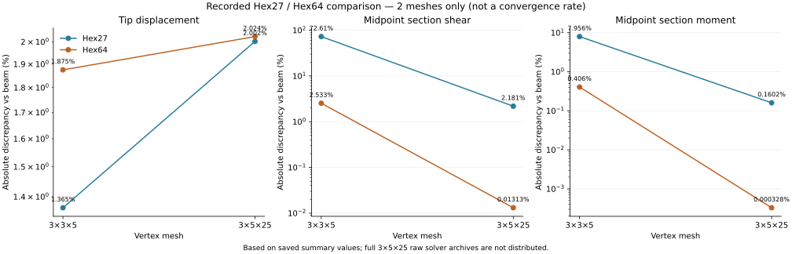

# Hex27 and Hex64 against cubic-recovery Hex8 — controlled research study

**27 October 2026 · experimental comparison · not certified**

This add-on **does not alter the existing Hermite solver**, its recovery weights, shape functions, KKT clamp, source-stress audit, or original results. A separate `tools/p_order_study.py` implements standard 3D Cauchy-elastic C0 tensor-product Lagrange Hex27 (degree 2) and Hex64 (degree 3). The existing cubic Hermite scheme is a Hex8 *topology*, six nodal DOFs, nonlocal recovery; it is **not** a conventional local 8-node trilinear Cauchy element. Do not conflate them.

A degree-2 hexahedron has a single quadrilateral *topological face* containing 9 interpolation nodes. Degree 3 has one face with 16 interpolation nodes. Neither automatically makes multiple independently bounded faces on each side. Splitting a side into more topological faces means subdividing the volume into more elements (**h-refinement**), a *different* controlled experiment.

## Mathematical definitions

On a regular axis-aligned source cell, `u_h(xi,eta,zeta) = sum_ijk L_i(xi)L_j(eta)L_k(zeta) u_ijk`, with Lagrange nodes `[-1,0,1]` for degree 2 and `[-1,-1/3,1/3,1]` for degree 3. There are 3 shared translational DOFs/node, no independent rotations. The Cauchy small-strain stiffness is

`K_e = integral_(Omega_e) B^T D B dV`,

using the same orthotropic Redwood stiffness matrix `D` (Voigt order `xx, yy, zz, xy, yz, xz`, engineering shear). Gravity is integrated `F_b = integral N^T (0,-rho,0) dV`; the end traction is integrated `F_t = integral_(z=L) N^T (0,P/(BH),0) dA`. Gaussian quadrature order is at least `p+1` per axis, with no reduced integration. The clamp imposes all displacements zero on `z=0`. It cannot fix *nodal spins* because this formulation has no spin DOFs.

The existing Hermite run by default constrains *both* the face displacement trace and nodal rotations. To get a closer common mechanical boundary condition, use `--displacement-only-clamp` with the Hermite runner and treat the resulting Hermite solve as a **new experiment** (do not claim numerical identity with the earlier fixed-spin 3×5×25 run). Even then, approximation spaces differ and the loading operators are distinct but weak-form consistent. For matched QoI evaluation, this add-on reproduces the Hermite source-section sampling convention at `zeta=-0.9,+0.9` and its `L/4` to `3L/4` summary; these sectional measurements are **not** 3D pointwise error norms.

## Chronological commands: Windows PowerShell

Use project root in VS Code, the Python environment already used by this repository, **no new virtual environment and no PyPardiso**.

```powershell
python -m pip install -r requirements.txt

# 1. Verification only: no structural solve
$env:OPENBLAS_NUM_THREADS = "1"
python -m unittest tests.test_p_order_study -v
python -m tools.p_order_study --mode verify --order 2
python -m tools.p_order_study --mode verify --order 3

# 2. Check dimensions and rough assembly storage; these DO NOT solve
python -m tools.p_order_study --mode plan --order 2 --nx 3 --ny 5 --nz 25
python -m tools.p_order_study --mode plan --order 3 --nx 3 --ny 5 --nz 25

# 3. Tiny 16-element smoke case first (2 x 2 x 4 physical elements)
python -m tools.p_order_study --mode solve --order 2 --nx 3 --ny 3 --nz 5 --out outputs/hex27_3x3x5.json
python -m tools.p_order_study --mode solve --order 3 --nx 3 --ny 3 --nz 5 --out outputs/hex64_3x3x5.json

# 4. Actual matched 3 x 5 x 25 VERTEX resolution (2 x 4 x 24 physical elements):
# Do this only with appropriate compute/RAM available.
python -m tools.p_order_study --mode solve --order 2 --nx 3 --ny 5 --nz 25 --out outputs/hex27_3x5x25.json
python -m tools.p_order_study --mode solve --order 3 --nx 3 --ny 5 --nz 25 --accept-expensive-run --out outputs/hex64_3x5x25.json

# 5. Optional: rerun the ORIGINAL cubic Hermite with displacement-only BC
#     (may also be computationally expensive; DO NOT treat as the previous fixed-spin case)
python -m tutorials.cubic --nx 3 --ny 5 --nz 25 --displacement-only-clamp --section-only --out outputs/cubic_3x5x25_displacement_clamp.json

# 6. Generate aligned comparison CSV after ALL THREE matching runs are complete
python -m tools.compare_p_order_outputs --cubic outputs/cubic_3x5x25_displacement_clamp.json --hex27 outputs/hex27_3x5x25.json --hex64 outputs/hex64_3x5x25.json --out outputs/p_order_3x5x25_comparison.csv
```

All `--mode solve` runs are **explicit opt-ins**. Without a `--mode`, the tool only prints a plan; the full 3×5×25 Hex64 run is intentionally blocked above 8,000 global DOFs unless you pass `--accept-expensive-run`. The flag does **not** guarantee the machine has enough RAM or that SciPy sparse LU will complete in a reasonable time. For the larger run, close other memory-intensive programs; a process-memory monitor is sensible.

### Exact sizes for the intended 3×5×25 comparison

| Scheme | Physical elements | Shared mesh nodes | Translation/spin DOFs | Face interpolation nodes |
|---|---:|---:|---:|---:|
| Existing nonlocal cubic Hermite Hex8 | 192 | 375 | 2,250 (6/vertex), plus independent KKT constraints | 4 geometric face corners; nonlocal trace |
| Standard quadratic Hex27 | 192 | 2,205 | 6,615 (3/node) | 9 |
| Standard cubic Hex64 | 192 | 6,643 | 19,929 (3/node) | 16 |

Numbers exclude the large fill-in of the sparse direct factorization. The Hex64 assembly has 7,077,888 uncoalesced dense local matrix contributions, about 162 MiB for bare 64-bit value plus two 64-bit indices alone; actual peak storage can be **substantially larger**.

### Outputs and diagnostic interpretation

Every solved case writes JSON and `*_sections.csv` with source (not visualization) stresses: `FE_shear_y_lbf=integral_A tau_yz dA`, `FE_bending_moment_x_lbf_in=integral_A y sigma_zz dA`, along with classical resultant references, relative discrepancies, and axial positions. The JSON also reports the signed tip displacement, mean and max-abs end-face nodal displacements, applied/resultant force and moment about the origin, reactions, free-DOF residual, Clapeyron discrete work/energy consistency, quadrature order, local polynomial and rigid-body checks, timings, element/node/DOF counts, and sparse nnz. A side-by-side comparison script refuses to silently compare meshes, modulus, end force, or weight that differ.

**Reference formulas and signs:** Downward `P<0` and `rho>0` in lbf/in³; `w=-rho*B*H` is signed load per length. At section `z` with `r=L-z`: `V_y = P - rho*BH*r` and `M_x = -P*r + (rho*BH/2)*r²`. Total externally applied force `F_y = P - rho*BHL` and external `M_x = -P*L + (rho*BH*L²)/2` about the fixed-face origin; the support reaction should cancel both. For the current example these are `-79.616 lbf` and `+5544.96 lbf·in`. The beam tip reference is `-0.1161490909 in` including distributed self-weight. No material calibration occurs.

### Small reproducibility smoke result (not the intended large study)

We ran only `nx=3, ny=3, nz=5` for both conventional element families, with 16 physical elements and translation-only clamps. These results were calculated using the new implementations; they are **not** manufactured reference answers or convergence claims:

| Metric | Hex27 | Hex64 |
|---|---:|---:|
| Tip max-abs signed `u_y` (in) | −0.117734255 | −0.118326902 |
| Max middle-half section shear vs 1D beam | 72.61185% | 2.53271% |
| Max middle-half section moment vs 1D beam | 7.95556% | 0.40601% |
| Global load and reaction equilibrium | pass (floating-point residual) | pass (floating-point residual) |
| Discrete work/energy | pass (floating-point residual) | pass (floating-point residual) |
| Rigid/affine/p-order polynomial interpolation | pass | pass |

This shows why simply seeing a high degree or good global equilibrium **does not** establish local shear stress accuracy: the coarse Hex27 shear discrepancy is very large despite the passing equilibrium check. It also makes Hex64 worth investigating further. Compare matching BCs and multiple meshes before attributing differences to polynomial degree alone.

### Latest matched-mesh result: 3×5×25

The repository now contains both conventional-element solves for the planned
3×5×25 vertex mesh (192 physical cells). Hex27 and Hex64 use the same
translation-only clamp, material, loads, source-section locations, and
middle-half summary. The cubic Hermite result is deliberately omitted from
this direct table: a 3×5×25 Hermite solve with the same displacement-only
clamp is not present in the outputs, and the older fixed-spin Hermite runs
have a different boundary condition.

| Element type | Physical elements | Global nodes | Translation DOFs | Tip vs beam (%) | Max middle-half section shear vs beam (%) | Max middle-half section moment vs beam (%) |
|:--|--:|--:|--:|--:|--:|--:|
| Standard quadratic Lagrange Hex27 | 192 | 2,205 | 6,615 | 2.0021 | 2.1811 | 0.16016 |
| Standard cubic Lagrange Hex64 | 192 | 6,643 | 19,929 | 2.0244 | 0.01313 | 0.000328 |



At this matched mesh, Hex64 gives the smaller reported section-shear and
section-moment discrepancies; Hex27 gives a slightly smaller tip-to-beam
discrepancy. This makes Hex64 the strongest current **section-resultant**
result among these two runs, not a universal winner or a certified-accuracy
claim. The beam model is not the exact 3D solution, and the reported stress
resultants are raw constitutive stresses.

The two mesh levels in the plot are the 3×3×5 smoke case (16 physical cells)
and 3×5×25 case (192 cells). Refinement changes the transverse and axial
divisions by different amounts, and the plot contains only two mesh levels.
It is a compact comparison of available results, **not a demonstrated
asymptotic convergence curve**. The older `cubic_densification.svg` remains a
separate Hex8 Hermite-only study and should not be repurposed as a Hex27/Hex64
plot. The full 3×5×25 solve output files in `outputs/` are **not shipped** in this
archive, and must be regenerated with the solve commands above. The plotted
historical summary values have been preserved in
`samples/hex27_hex64_recorded_mesh_summary.json` (they are not a substitute
for fresh raw solver outputs). Regenerate the existing chart **from those recorded values**:

```powershell
python -m tools.plot_p_order_comparison
```

For numerical independent reproduction, run both expensive 3×5×25 solves
explicitly, and compare the resulting JSON and section CSV files before
updating the recorded summary. Do not confuse a reproducible *plot* with a
freshly reproduced *large solve*.

### Limits and next steps toward a posteriori certification

These element families are *unconditionally new research baselines*, not a certified improvement and not a replacement for the existing cubic solver. They do **not** implement error estimators, guaranteed bounds, adaptive mesh marking, global equilibrated stress fields, face-traction jump residuals or a complete 3D elasticity comparison. The current outputs do **not** measure all pointwise stresses. Especially near the clamp and sharp edges, use stress QoIs away from singular or boundary-condition-dominated locations.

For future assessment: (1) repeat same-mesh p=2 and p=3 with matched clamp; (2) examine 3D stress sampling in consistent norms, interface tractions and natural boundary residuals; (3) run h-refinement at each p with fixed sample definitions; (4) compare tip, section integrals and interior volume-norm stress quantities separately; (5) if the proof framework is ready, implement a globally equilibrated stress reconstruction and a valid reliability bound. Do not relabel agreement with 1D beam theory as a certified 3D FE error bound.
